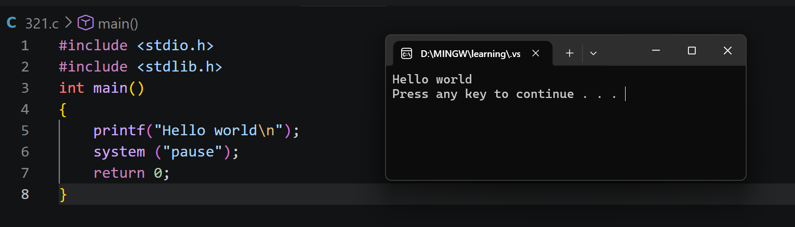
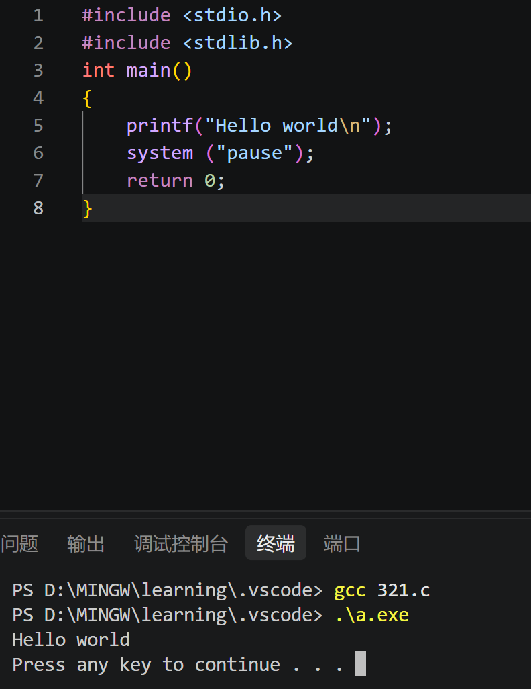

# Part_1
## 1
- 1.GCC:C语言的编译器，将其翻译成二进制程序方便电脑执行
- 2.MinGW:Windows系统下的GCC编译器环境，让开发者能在Windows上使用GCC编译出Windows的.exe程序
## 2
- 1.c_cpp_properties.json:智能提示,提供代码的补全、语法高亮，和错误提示
- 2.launch.json:调试配置，告诉VS Code如何启动调试器，如何如何运行和调试程序
- 3.tasks.json:编译任务配置，告诉 VS Code 如何编译代码
## 3
- 1.为什么:VS Code本身不认识C语言，也没有编译和调试能力
- 2.作用:让VS Code认识C语言，进而建立C语言集成开发环境
## 4
-{

    "configurations": [
        {
            "name": "gcc.exe - ⽣成和调试活动⽂件",  // 该调试任务的名字，启动调试时会在待选列表中显⽰
            "type": "cppdbg",
            "request": "launch",
            "program": "${fileDirname}\\${fileBasenameNoExtension}.exe",            "args": [],
            "stopAtEntry": false,  //程序启动时直接运行还是暂停在main函数的第一行
            "cwd": "${workspaceFolder}",
            "environment": [],
            "externalConsole": false,  //黑框内置还是外置
            "MIMode": "gdb",
            "miDebuggerPath": "C:\\mingw64\\bin\\gdb.exe",  //调试器的路径
            "setupCommands": [
                {
                    "description": "为 gdb 启⽤整⻬打印",
                    "text": "-enable-pretty-printing",
                    "ignoreFailures": true
                }
            ],
            "preLaunchTask": "C/C++: gcc.exe build active file"  // 调试前的预执⾏任务，这⾥的值是tasks.json⽂件中对应的编译任务，也就是调试前需要先编译
        }
    ]
}
- 
- 
# Part_2
## 1
- 1.变量类型:变量类型规定了一个变量能存放什么种类的数据、占多少内存、能做哪些运算
- 2.重要性：变量类型决定数据的解释方式、取值范围和合法操作
- 3.18：整型int
- 4.apple:不能
- 5.字符串 char word[]= "apple";
## 2
- 1.第一个元素:从0开始
- 2.超出其有效范围：会导致程序崩溃或读到错误数据等
- 3.错误:
- 常见:arr[0]与现实常从一开头不同，容易导致习惯错误
- 危险:编译器通常不检查运行时下标，越界可能破坏内存
## 3
- 1.重复执行
- for:
- for (初始化; 条件判断; 迭代) 
- {
-   //循环体
- }
- while:
- while (条件) 
- {
-  // 循环体
- }
- 2.for:
- 初始化：循环开始前执行一次，用来准备循环所需的状态
- 条件判断：每轮循环前判断，为真才执行循环体，为假退出循环
- 迭代：每轮循环体执行后执行，可用来限制迭代次数
- 3.关键区别:while循环先判断条件，再决定是否执行，可能一次都不执行；do…while循环先执行一次循环体，再判断条件，至少执行一次
## 4
- 1.本质区别:
- 逻辑表达式:运算对象为条件，运算结果为真假
- 算术表达式:运算对象和运算结果均为数值
- 2.含义:
- &&:逻辑与，左右两边都为真才为真;
- ||:逻辑或，至少一边为真就为真；
- ！:逻辑非，真假互换
# Part_3
- 1.a,b的值无法互换
- 2.指针