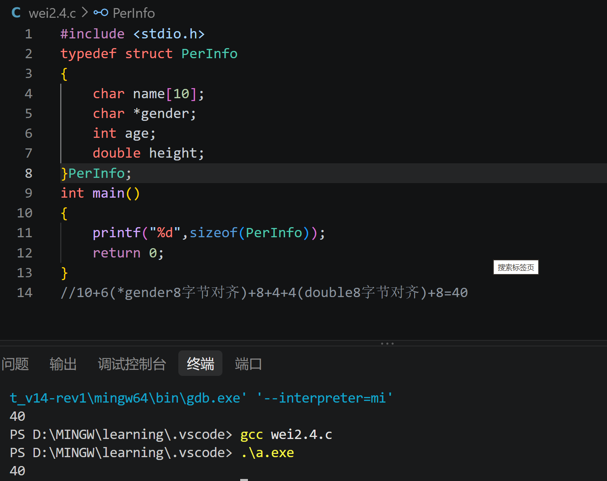
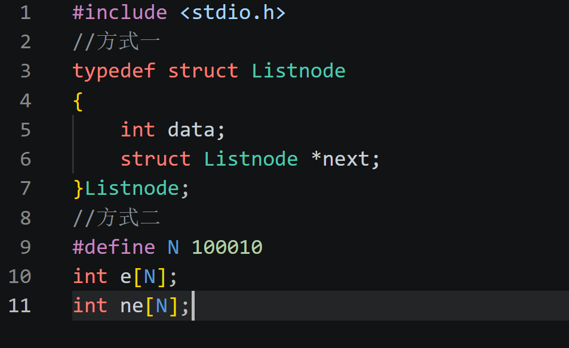

# Part_1
## 1
- 1.定义:类型 *指针变量名
- 2.大小:不固定，由目标平台和编译器决定
## 2
- 1：x =20,y = 10.
- 2.原因:int* p = &x赋予地址，*p = 20在地址层面将x的值修改为20；int *q = arr，q =arr[0],++*arr 等价于 ++(*arr),则++*arr = 3 + 1 =4，*++q指向下一个地址arr[1]=6,4+6=10.
## 3
- 1.什么是野指针:野指针通常指未初始化、已失效或指向不可用内存的指针.
- 2.危害:可能导致程序崩溃、读到错误数据或破坏内存
- 3.避免:
- (1)定义指针时初始化
- (2)注意数组边界和指针运算范围
- (3)指针指向有效对象后再使用
# Part_2
- 1,3.
- 内存对齐规则:
- (1)每个成员相对于结构体起始地址的偏移量，必须是该成员对齐数的整数倍
- (2)不满足时，编译器在成员之间插入填充字节
- (3)结构体总大小必须是最大成员对齐数的整数倍，必要时在末尾填充
- 2.结构体指针:结构体指针是指向结构体类型对象的指针.
# Part_3
- 1.区别:
- (1)数组需要连续内存，链表则无需连续内存
- (2)数组大小固定，改变大小较困难，链表大小可变，改变容易
- 2.单向链表节点的结构特点:
- (1)节点结构体内部必须包含一个指向自身相同类型的指针
- (2)包含数据域和指针域两个部分
- (3)只能从头节点出发，顺着指针单向访问后续节点，无法逆向访问前一个节点
- (4)单向链表的最后一个节点的指针域必须指向空指针，表示链表的结束
-  